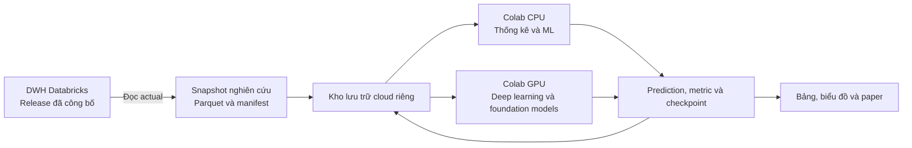

# Kế hoạch paper: Survey và benchmark dự báo doanh thu, giá vốn

Bộ bàn giao: [Bối cảnh](PROJECT_CONTEXT.md), [Hướng dẫn agent](AGENTS.md), [Hướng dẫn Claude](CLAUDE.md), [Trạng thái và bước tiếp](HANDOFF.md). Cập nhật 23/10/2026: người dùng giao triển khai/train trên Colab miễn phí. Xem [CLOUD_RUN.md](CLOUD_RUN.md).

Ngày lập: 22/10/2026. Cập nhật: 23/10/2026. Trạng thái: **đã bắt đầu triển khai pilot Colab CPU; chưa có kết quả train cloud**.

## 1. Yêu cầu đã chốt

- Phạm vi hiện tại: triển khai pilot Colab miễn phí theo yêu cầu mới. Chưa có training cloud thành công; chưa triển khai toàn bộ 40 model.
- Paper theo hướng **survey + empirical benchmark** trên dữ liệu Retail Analytics từ DWH Databricks.
- Code nghiên cứu và mô hình nằm trong repository riêng, không tích hợp vào hệ thống hiện tại.
- Target: G và COGS theo ngày. G là doanh thu gộp, gồm đơn hủy, chưa trừ chiết khấu.
- Horizon: 7, 30, 90, 365 và 548 ngày.
- Survey khoảng 80 phương pháp/biến thể; thực nghiệm 40 đại diện, sau đó phân tích sâu một nhóm finalist.
- Chỉ số bắt buộc: MAE, MAPE, RSE. RSE được chốt là **Relative Squared Error, không lấy căn**.
- Có biểu đồ train, test, cross-validation và đánh giá chi phí tính toán.
- **Không huấn luyện ở local.** CPU và GPU phục vụ thí nghiệm đều nằm trên cloud. Máy cá nhân chỉ cần trình duyệt để điều khiển và xem kết quả.
- Ngân sách thuê compute và hạn nộp paper chưa được xác định; lộ trình tám tuần bên dưới là dự kiến.

## 2. Mục tiêu và câu hỏi nghiên cứu

Tên paper dự kiến:

> A Survey and Empirical Benchmark of Statistical, Machine Learning, Deep Learning, and Foundation Models for Daily Retail Revenue and Cost Forecasting

| Mã | Câu hỏi |
|---|---|
| RQ1 | Họ mô hình nào dự báo G và COGS tốt hơn ở từng horizon? |
| RQ2 | Mức cải thiện so với baseline có ổn định qua các giai đoạn không? |
| RQ3 | Biến lịch, độ dài lịch sử và thay đổi cấu trúc chuỗi ảnh hưởng thế nào đến kết quả? |
| RQ4 | Độ chính xác đánh đổi thế nào với thời gian train, inference và bộ nhớ? |
| RQ5 | Dự báo COGS trực tiếp hay qua tỷ lệ COGS/G hiệu quả hơn? |

Đóng góp dự kiến: giao thức đánh giá thống nhất, artifact tái lập được, bảng so sánh nhiều họ mô hình và phân tích điều kiện áp dụng. Chưa có kết quả để khẳng định mô hình nào thắng. Kết luận chỉ giới hạn trong dataset và giao thức thực nghiệm này.

## 3. Kiến trúc chạy hoàn toàn trên cloud

### 3.1. Phương án mặc định: Colab CPU + Colab GPU

- Repository nghiên cứu độc lập `retail-sales-forecasting-research`, lưu code/config/notebook trên Git; mở notebook qua trình duyệt.
- Colab CPU chạy baseline, thống kê, ML, chấm điểm và sinh hình; không giữ GPU cho các tác vụ không sử dụng GPU.
- Colab GPU chạy neural models và inference của foundation models.
- Snapshot và kết quả nằm trong một thư mục Drive riêng hoặc object storage; không chỉ lưu trong ổ tạm của runtime.
- Mỗi phiên tải bản snapshot nhỏ xuống ổ tạm của VM cloud để xử lý; ghi kết quả và checkpoint trở lại kho bền vững sau từng đơn vị chạy.
- Máy cá nhân không cần GPU, không phải giữ tiến trình train và không cần tải toàn bộ dữ liệu giao dịch.

Theo [Colab FAQ](https://research.google.com/colaboratory/faq.html), Colab cung cấp notebook trên VM cloud; tài nguyên, GPU và thời lượng phiên có thể thay đổi. Bản trả phí cũng không bảo đảm tài nguyên vô hạn. Vì vậy kế hoạch bắt buộc có checkpoint và resume; không hứa hoàn thành toàn bộ benchmark bằng quota miễn phí.

### 3.2. Khi Colab không đủ

Phương án dự phòng là VM CPU/GPU cloud có cấu hình cố định. Giữ nguyên snapshot, config, adapter và định dạng artifact; thay nơi thực thi runner. Dùng VM cố định khi cần chạy dài hoặc đo hiệu suất trên cùng phần cứng giữa nhiều model. Chỉ chọn nhà cung cấp và thuê máy sau khi có số đo pilot và mức ngân sách được chốt.

Databricks có thể là nơi chạy thí nghiệm nếu workspace thực tế có compute và quyền phù hợp. Đây là phương án cần khảo sát riêng, chưa phải mặc định; chưa xác minh loại tài khoản, khả năng GPU, quota hoặc giá. Việc DWH chạy trên Databricks không buộc model phải train cùng nền tảng.

### 3.3. Ranh giới với hệ thống hiện tại

- Databricks cung cấp actual và thông tin nguồn; nghiên cứu dùng kết nối chỉ đọc.
- Code model không nằm trong `scripts/forecast/`, app, dbt hay Airflow hiện tại.
- Không nhập module model hiện tại làm dependency của repository nghiên cứu.
- Không ghi prediction nghiên cứu vào các bảng đang phục vụ ứng dụng.
- Kế hoạch, tài liệu và code nghiên cứu nằm trong repository này; không dùng Git submodule, symlink hoặc dependency tới repository hệ thống chính.
- Chưa tạo hoặc sửa bất kỳ tài nguyên cloud nào trong đợt lập kế hoạch.

## 4. Dữ liệu và provenance

### 4.1. Nguồn trích xuất

Ưu tiên `rpt_forecast_actual` trong schema reporting vật lý của một release đã công bố. SQL của hệ thống nguồn được đọc khi lập kế hoạch ngày 22/10/2026 cho thấy bảng này có `sale_date`, `g`, `cogs`, được dựng từ `fact_daily_sales` join `dim_date` và lọc `is_actual = true`.

Quy trình dự kiến:

1. Trên runtime cloud, đọc registry bằng thông tin xác thực chỉ đọc, xác định release đã công bố.
2. Cố định `release_id`, catalog và schema vật lý cho toàn bộ lượt export.
3. Đọc actual của release đó và lưu Parquet tại kho nghiên cứu riêng.
4. Lưu SQL, thời điểm export, số dòng, khoảng ngày, tổng target và SHA-256 của artifact.
5. Mọi run dùng snapshot đã đóng băng; không truy vấn lại DWH trong mỗi fold.

Nếu thiếu bảng reporting actual, truy vấn tương đương từ `fact_daily_sales` và `dim_date` của cùng release, nếu có quyền. Nếu thiếu quyền đọc thì dừng bước export và ghi rõ thiếu quyền nào; không dùng nhãn dự báo thay actual.

Thông tin xác thực lấy từ secret facility của runtime, không đặt trong notebook, output hoặc Git. Chỉ chuyển hai chuỗi tổng hợp cần thiết sang môi trường nghiên cứu.

### 4.2. Hợp đồng snapshot

| Cột | Ý nghĩa |
|---|---|
| `ds` | Ngày kinh doanh |
| `unique_id` | `G` hoặc `COGS` |
| `y` | Giá trị thực tế |
| `release_id` | Release của DWH |
| `snapshot_id` | Snapshot nghiên cứu |

Grain: một target trong một ngày. Theo tài liệu hiện có, lịch sử là 04/07/2012–31/12/2022, gồm 3.833 ngày, tương ứng 7.666 dòng ở dạng dài. Đây là mốc dự kiến cần xác nhận lại bằng export cloud; chưa phải kết quả truy vấn live trong phiên lập kế hoạch.

### 4.3. Kiểm tra dữ liệu bắt buộc

- Không trùng `(unique_id, ds)`; hai target có cùng lịch ngày.
- Không thiếu ngày, null hoặc giá trị vô hạn; thống kê số giá trị 0 và âm.
- Đối soát số dòng, ngày đầu/cuối, tổng G/COGS và tổng từng tháng với DWH.
- Tuyệt đối loại dòng giữ chỗ `is_actual = false`; `sample_submission` không phải nhãn thực tế.
- Không tự gán ngày thiếu bằng 0, xóa outlier hoặc cắt ngọn giá trị; bất thường được gắn cờ và điều tra.
- Chỉ chạy benchmark sau khi snapshot vượt qua kiểm tra.

### 4.4. Kiến thức có trước nghiên cứu

Tài liệu repo ghi nhận thay đổi cấu trúc cuối 2018, mùa vụ theo tháng, hiệu ứng ngày trong tháng, khác biệt tháng 8 năm chẵn/lẻ và việc các bảng phụ dừng ở 2022. Ghi rõ đây là hiểu biết đã có từ dự án. Không coi các đặc điểm này là phát hiện mới trên test.

Mọi kết luận thực nghiệm mới trong paper phải truy ngược được đến bảng số hoặc cell đã chạy. Nguồn bối cảnh đã tham khảo ngày 22/10/2026: CLAUDE.md, hợp đồng dự báo và sổ quyết định GĐ2 của hệ thống cung cấp dữ liệu. Đây là nguồn tham khảo lịch sử, không phải dependency hoặc file bắt buộc để chạy nghiên cứu. Hợp đồng dữ liệu và phương pháp cần thiết được mô tả ngay trong tài liệu này. Hợp đồng nghiên cứu riêng dưới đây không thay đổi luật chọn model production.

## 5. Survey tài liệu và danh sách ứng viên

### 5.1. Quy trình literature review

Ngày chốt tài liệu ban đầu: 22/10/2026. Tìm theo các nhóm từ khóa retail sales forecasting, revenue forecasting, multi-horizon forecasting, statistical/ML/deep/foundation forecasting và benchmark evaluation. Ưu tiên paper gốc, tài liệu tác giả và code chính thức.

Mỗi tài liệu có: tên model, năm, DOI/arXiv, họ mô hình, dữ liệu nghiên cứu, đầu vào, chiến lược nhiều bước, horizon, cách chia tập, metric, compute, code/checkpoint/license và lý do chạy hoặc chỉ survey. Lưu câu truy vấn tìm kiếm và ngày truy cập. Không gọi đây là systematic review đầy đủ nếu chưa thực hiện quy trình tìm kiếm và sàng lọc tương ứng.

Không ghép điểm số từ các dataset/giao thức khác nhau thành bảng xếp hạng chung. Số 80 dưới đây là phương pháp/biến thể, không phải 80 kiến trúc hoàn toàn độc lập.

### 5.2. Bốn mươi ứng viên chạy thực nghiệm

| Nhóm | Mã và model |
|---|---|
| Baseline, 6 | 01 Historical Mean; 02 Naive; 03 Drift; 04 Seasonal Naive 7 ngày; 05 Seasonal Naive cùng ngày năm trước; 06 Seasonal Naive cùng ngày hai năm trước |
| Thống kê, 10 | 07 Simple Exponential Smoothing; 08 Damped Holt; 09 AutoETS; 10 Theta; 11 AutoARIMA; 12 log-SARIMAX với lịch/Fourier; 13 STL–ETS; 14 TBATS; 15 Prophet; 16 Dynamic Harmonic Regression với Ridge |
| Machine learning, 11 | 17 Linear Regression; 18 Ridge; 19 ElasticNet; 20 Huber Regression; 21 KNN Regression; 22 SVR–RBF; 23 Random Forest; 24 Extra Trees; 25 XGBoost; 26 LightGBM; 27 CatBoost |
| Deep learning, 9 | 28 MLP; 29 LSTM; 30 GRU; 31 TCN; 32 N-BEATS; 33 N-HiTS; 34 DLinear; 35 PatchTST; 36 TFT |
| Foundation models, 4 | 37 Chronos-Bolt Small; 38 Chronos-2; 39 TimesFM 2.5; 40 Moirai 2.0 Small |

Khóa version thư viện và revision checkpoint trước benchmark. Foundation models chạy zero-shot trong phần chính. Chi phí pretraining không nằm trong chi phí đo được của nghiên cứu và không được ghi thành 0.

### 5.3. Bốn mươi ứng viên mở rộng trong survey

| Nhóm | Danh sách |
|---|---|
| Thống kê, 5 | Holt không damping, Seasonal Window Average, AutoCES, MSTL–ARIMA, BATS |
| Nhu cầu gián đoạn, 5 | Croston, Croston–SBA, TSB, ADIDA, IMAPA |
| Machine learning, 5 | Lasso, Bayesian Ridge, Gaussian Process Regression, HistGradientBoosting, Cubist |
| Deep learning, 10 | Simple RNN, Dilated RNN, BiTCN, N-BEATSx, NLinear, TiDE, DeepAR, DeepState, ESRNN, DeepNPTS |
| Transformer/mixing, 7 | Informer, Autoformer, FEDformer, TimesNet, TimeMixer, iTransformer, TSMixer |
| Foundation models, 8 | TimesFM 3.0, TimesFM 2.0, Chronos-T5, Moirai 1.0, Moirai-MoE, Tiny Time Mixers, Lag-Llama, TimeGPT |

Nhóm nhu cầu gián đoạn chỉ chuyển sang thực nghiệm nếu bài toán có chuỗi phù hợp; không ép vào chuỗi tổng doanh thu liên tục. TimesFM 3.0 được survey nhưng cấu hình thực nghiệm chính giữ 2.5; kiểm giấy phép từng checkpoint trước khi sử dụng. Không chạy API model trả phí trong benchmark mặc định.

## 6. Train, validation, test và cross-validation

### 6.1. Phân chia thời gian

| Phần | Khoảng thời gian | Vai trò |
|---|---|---|
| Development | 04/07/2012–01/07/2021 | Khảo sát, CV, tuning và chọn model |
| Final test | 02/07/2021–31/12/2022, đúng 548 ngày | Đánh giá sau khi khóa cấu hình |
| Future application | 01/01/2023–01/07/2024 | Dự báo minh họa; không chấm accuracy khi chưa có actual |

Lịch sử đã từng được khám phá trong dự án. Test mới được tách khỏi fitting/tuning của nghiên cứu này, nhưng không thể gọi là dữ liệu hoàn toàn chưa từng được nhìn thấy. Paper phải ghi đây là benchmark hồi cứu.

### 6.2. Năm fold rolling-origin

Train mặc định bắt đầu 04/07/2012. Mỗi origin dự báo riêng H = 7, 30, 90, 365, 548 ngày. Không shuffle và không random K-fold.

| Fold | Ngày cuối train | Ngày cuối validation H=548 |
|---|---|---|
| F1 | 31/12/2017 | 02/07/2019 |
| F2 | 30/06/2018 | 30/12/2019 |
| F3 | 31/12/2018 | 01/07/2020 |
| F4 | 30/06/2019 | 29/12/2020 |
| F5 | 31/12/2019 | 01/07/2021 |

Các cửa sổ dài chồng lấn; giữ cả `origin` và `ds` trong prediction. Báo từng fold, không coi năm fold là năm mẫu độc lập để áp t-test thông thường. Origin ngắn hạn tập trung đầu năm/giữa năm nên kết luận chưa đại diện mọi mùa.

### 6.3. Final test

Khóa cấu hình, fit lại trên development đến 01/07/2021 rồi dự báo năm horizon từ origin này. Không cập nhật model bằng actual giữa horizon. H=548 dự báo một lần toàn khoảng 548 ngày; H=7 chấm riêng bảy ngày đầu. Đây không phải thử nghiệm hệ thống retrain mỗi ngày.

Không thay cấu hình, chọn seed hoặc thêm feature sau khi xem test. Kết quả khảo sát thêm sau đó phải ghi exploratory và không thay thế bảng test đã đăng ký.

### 6.4. Kiểm soát leakage

- Fit scaler, feature selection, imputer và decomposition trong train từng fold.
- Rolling feature dùng dữ liệu đã shift về quá khứ.
- Toàn bộ nhãn của một cửa sổ supervised training phải nằm trước hoặc tại cutoff.
- Dự báo recursive chỉ dùng prediction của bước trước khi đi qua origin.
- Early stopping dùng validation nội bộ trong train.
- Changepoint, ngưỡng bất thường và quy tắc được học không được fit trên toàn chuỗi rồi áp ngược.
- Tỷ lệ COGS/G dùng actual train, không dùng actual tương lai để tính dự báo COGS.

## 7. Feature và quy tắc so sánh

| Bộ | Nội dung |
|---|---|
| F0 | Lịch sử riêng của target |
| F1 | F0 + tháng, ngày trong tháng, số ngày trong tháng, khoảng cách tới cuối tháng, Fourier năm |
| F2 | F1 + kiến thức nghiệp vụ có trước: chẵn/lẻ và cờ mùa Urban Blowout |
| F3 | F1 + lịch sử target còn lại, chỉ dùng trong thí nghiệm đa biến bổ sung |

F1 là mặc định cho tabular và model hỗ trợ covariate. Model chỉ nhận chuỗi dùng F0; luôn công khai cột input set. So sánh chính đánh giá phương pháp hoàn chỉnh, không khẳng định cô lập ảnh hưởng kiến trúc. Ablation F0/F1 giúp kiểm ảnh hưởng feature trên cùng model. F2 được báo riêng vì có kiến thức EDA từ trước.

Tabular models dùng lag 1, 2, 3, 7, 14, 28, 30, 60, 90, 180, 365, 730; rolling mean/std cửa sổ 7, 28, 90, 365. Mặc định dự báo một bước rồi recursive. Với hai model cây tốt nhất, bổ sung direct nhiều bước bằng mô hình chung có `lead_time`; các nhãn train phải kết thúc trước cutoff.

Quy tắc chung:

- Hai target được train riêng trong benchmark chính.
- Cùng snapshot, origin, horizon, ngày chấm và đơn vị tiền.
- Dự báo âm chặn ở 0 cho tất cả model; lưu prediction gốc và số lần chặn.
- Không ép COGS nhỏ hơn hoặc bằng G.
- Biến đổi log được đảo về tiền trước khi chấm; ghi rõ point forecast là mean hay median.
- Seasonal Naive theo năm ánh xạ cùng ngày theo lịch; 29/02 về 28/02 khi cần. Ngày tham chiếu vượt origin dùng prediction đã sinh, không actual.
- Model có giới hạn output ngắn hơn H dùng adapter recursive theo khối chỉ khi hợp lệ; ghi chiến lược. Không hỗ trợ thì đánh dấu `unsupported`, không ngầm thay bằng baseline.
- Mô hình lớn không được ưu tiên trước; hai chuỗi khoảng 3.800 điểm là giới hạn cần thảo luận.

## 8. Metric và luật chọn

Với e_t = y_t − yhat_t, tính riêng theo target/fold/horizon:

| Metric | Công thức | Cách đọc |
|---|---|---|
| MAE | mean(abs(e)) | Sai lệch trung bình theo tiền |
| MAPE | 100 × mean(abs(e) / abs(y)) | Sai lệch phần trăm |
| RSE | sum(e²) / sum((y − mean(y))²) | Relative Squared Error, không căn |
| RMSE | sqrt(mean(e²)) | Nhấn mạnh sai số lớn |
| MASE | MAE / mean(abs(y_train[t] − y_train[t−365])) | Chuẩn hóa theo sai số seasonal trong train |
| WAPE | 100 × sum(abs(e)) / sum(abs(y)) | Lỗi tương đối tổng thể |
| Bias | mean(yhat − y) | Dự báo thiên cao hoặc thấp |
| Sai số tổng kỳ | sum(yhat) − sum(y) | Sai lệch tổng doanh thu/giá vốn |

Nếu y có 0: MAPE chuẩn không xác định; có thể báo thêm `MAPE_nonzero` và coverage. Mẫu số RSE/MASE/WAPE bằng 0 thì ghi không xác định. Không thêm epsilon tùy ý. MAPE tháng tính từ tổng tháng hoàn chỉnh, không lấy trung bình MAPE ngày rồi đổi tên.

Luật xếp hạng:

1. Bảng chính trình bày MAE theo từng target/horizon.
2. Chọn finalist bằng trung bình MASE, trọng số bằng nhau cho hai target, năm horizon và năm fold.
3. Ứng viên thiếu nhiệm vụ không được hưởng điểm trung bình tốt hơn do bỏ các ca khó; để bảng incomplete riêng.
4. Hòa trong 1% thì ưu tiên inference nhanh hơn trên cùng hardware; nếu chưa có phép đo tương đương, đo lại nhóm hòa trước khi chọn.
5. RSE, MAPE, RMSE và Bias dùng giải thích đánh đổi. Không cộng trực tiếp các metric khác đơn vị.
6. Báo thêm MAE tháng 8 năm lẻ cho những fold có kỳ đó.

Một số paper gọi Root Relative Squared Error là RSE. Khi review phải ghi công thức gốc, không coi hai định nghĩa tương đương.

## 9. Các vòng thực nghiệm và ngân sách

### A. Pilot cloud

Chạy đại diện mỗi họ trên F5, H=30 và H=548, seed 42. Kiểm adapter, đủ ngày, metric, RAM/VRAM, thời gian, khả năng chạy dài, checkpoint và resume. Đo riêng setup/download, fit và predict. Khóa môi trường trước benchmark.

### B. Screening 40 ứng viên

40 model × 2 target × 5 horizon × 5 fold = **2.000 đơn vị đánh giá**. Một lần fit có thể phục vụ nhiều horizon nếu phương pháp cho phép; không gọi đây là 2.000 lần train bắt buộc. Dùng seed 42 và cấu hình đăng ký trước khi xem điểm. Lưu lỗi hội tụ, OOM, timeout và unsupported.

### C. Chọn finalist

Chọn 2 thống kê, 3 ML, 2 DL và 1 foundation model theo điểm development. Giữ thêm Seasonal Naive một/hai năm làm đối chứng. Không chọn finalist theo final test.

### D. Tuning có giới hạn

- Bảy model có training: tối đa 12 cấu hình mỗi model–target; objective trung bình MASE trên H=30 và H=548.
- Ba origin nội bộ cho mỗi H: origin cuối = 01/07/2021 − H ngày; hai origin khác lùi thêm 90 và 180 ngày. Nhãn validation không vượt development.
- Early stopping dùng phần train của từng origin. Search space lưu trong config trước khi xem kết quả tuning.
- Một cấu hình chung chuyển sang các horizon còn lại; chiều đầu ra phụ thuộc H vẫn fit riêng khi cần.
- Foundation finalist khảo sát context 365, 730, tối đa 1.460 ngày trong giới hạn checkpoint; không fine-tune trọng số.
- Điểm development sau selection/tuning là điểm phục vụ chọn model, không phải đánh giá độc lập.

### E. Nhiều seed và final test

Finalist ngẫu nhiên dùng seed 17, 42, 2024, 2025, 2026; model xác định chạy một lần. Khóa cấu hình trước khi mở test. Báo 40 cấu hình ban đầu và finalist tuned thành nhóm rõ ràng. Báo trung bình/độ lệch chuẩn seed, không chọn seed tốt nhất hoặc coi seed là dataset độc lập.

### F. Ablation đăng ký trước

Trên finalist, ưu tiên H=30 và H=548:

- F0/F1/F2 và có/không ngày trong tháng.
- Toàn lịch sử so với 730/1.095 ngày gần nhất.
- Raw so với log1p.
- Recursive so với direct trên hai model cây tốt nhất.
- COGS trực tiếp so với G dự báo nhân tỷ lệ COGS/G dự báo.

Chỉ so trên fold đủ lịch sử cho cả hai phương án. Train từ 2019 là phân tích riêng trên origin phù hợp, không áp cho fold trước 2019. Nếu G=0, phương án tỷ lệ phải ghi không áp dụng cho ca đó hoặc đăng ký quy tắc hợp lệ trước khi chấm; không sửa mẫu số âm thầm.

### G. Quản lý phiên cloud và chi phí

- Chia nhiệm vụ theo model/target/horizon/fold/seed; ghi trạng thái bền vững sau từng nhiệm vụ.
- Trước mỗi phiên, kiểm checksum snapshot, config và code revision; resume chỉ nhận artifact cùng định danh.
- Lưu checkpoint neural định kỳ trên cloud storage. Mất phiên thì tiếp tục từ checkpoint hợp lệ, hoặc chạy lại riêng nhiệm vụ dở.
- Hết quota hoặc thiếu GPU: tạm dừng hàng đợi, không chuyển sang train local.
- Pilot dùng để tính dự toán giờ CPU/GPU cho screening, tuning và seed bổ sung; không hứa thời gian chạy hoặc chi phí trước phép đo.
- Trước khi chạy trả phí phải có trần ngân sách. Khi chạm trần, giữ kết quả và báo phần còn thiếu; không tự tăng ngân sách hoặc đổi protocol để làm đẹp kết quả.

## 10. Hiệu suất và biểu đồ

### 10.1. Hiệu suất đo được

Lưu feature time, fit time, predict time, tuning time gồm trial thất bại, RAM/VRAM đỉnh, model size, số tham số nếu có, CPU/GPU, thread count và phiên bản môi trường. Download checkpoint/setup tính riêng. Đồng bộ GPU trước khi chốt thời gian.

Inference latency: median năm lần sau warm-up. Chia kết quả theo hardware; Colab cấp GPU khác nhau thì không gộp latency thành phép so kiến trúc thuần túy. Với nhóm finalist cần kết luận về tốc độ, chạy lại trên cùng loại thiết bị. Chi phí pretraining của foundation model ghi ngoài phạm vi đo.

### 10.2. Bộ hình bắt buộc

| Hình | Nội dung |
|---|---|
| 1 | G/COGS toàn lịch sử và đường chia development/test |
| 2 | Sơ đồ năm fold theo thời gian |
| 3 | Mùa vụ theo tháng/ngày trong tháng trên development |
| 4 | Actual và fitted values trên train cho finalist |
| 5 | Actual và forecast trên final test, mỗi model một ô |
| 6 | Phóng to tháng 8 năm lẻ và các kỳ sai số lớn |
| 7 | Heatmap MAE/MASE theo model × horizon, tách target |
| 8 | Điểm từng fold và dao động giữa seed |
| 9 | MAE theo lead time/nhóm lead time |
| 10 | Residual distribution và tự tương quan residual |
| 11 | Độ chính xác so với thời gian fit/predict |
| 12 | Độ chính xác so với RAM/VRAM |
| 13 | Ablation |
| 14 | Tổng actual và forecast theo tháng hoàn chỉnh |

Không vẽ 40 đường chồng nhau. Fitted train chỉ để chẩn đoán, không chứng minh khả năng dự báo. Foundation model không có fitted curve tương đương thì ghi không áp dụng. Xuất PDF/SVG và PNG 300 DPI, ghi đơn vị/target/kỳ/legend; mọi hình được sinh từ artifact.

## 11. Thiết kế repository và hợp đồng đầu ra

Cấu trúc dự kiến của repository nghiên cứu riêng:

- `configs/`: snapshot, split, model registry, search space, ngân sách.
- `src/`: export, feature, adapter, runner, metric, plotting.
- `notebooks/`: kiểm dữ liệu, điều khiển cloud run, diễn giải.
- `tests/`: metric, split, leakage, adapter, resume.
- `paper/`: bản thảo, bibliography, script sinh bảng/hình.
- `artifacts/`: đường dẫn logic tới snapshot/result/checkpoint trên cloud; dữ liệu/output nặng không commit Git.

Môi trường CPU, neural và foundation có lockfile riêng khi dependency xung đột. Artifact Parquet/JSON là giao diện giữa các môi trường.

Adapter dự kiến có `fit(train_data, config, seed)` và `predict(future_dates, known_future_features)`. Runner kiểm contract và ghi manifest; foundation adapter có thể không cập nhật trọng số trong `fit` nhưng phải khai báo zero-shot.

Prediction gồm:

`run_id, snapshot_id, model_id, config_id, seed, target, split, fold_id, origin, horizon, ds, lead_time, y_true, y_pred_raw, y_pred, forecast_strategy`.

Metric gồm khóa run, tên metric, giá trị, số quan sát hợp lệ và trạng thái. Status: `success`, `failed`, `timeout`, `oom`, `unsupported`. Không âm thầm loại run lỗi. Một khóa thí nghiệm chỉ có một kết quả được chấp nhận; retry giữ lịch sử attempt riêng.

## 12. Kiểm thử và nghiệm thu

| Kiểm thử | Tiêu chí |
|---|---|
| Metric | Khớp bộ số tính tay; xử lý zero/constant series đúng |
| Split | Train trước validation/test; đủ H ngày |
| Leakage | Sửa dữ liệu sau origin không đổi feature/scaler/prediction tại origin đó |
| Supervised windows | Không nhãn train nào vượt cutoff |
| Adapter | Đủ ngày, không trùng, không NaN/Inf |
| Calendar | Năm nhuận và seasonal reference đúng |
| Tái lập | Cùng snapshot/config/seed khớp trong tolerance khai báo |
| Resume | Không trộn snapshot, không trùng kết quả, checkpoint khôi phục được |
| Report | Bảng và hình tính lại được từ prediction |
| Cloud smoke | Một model CPU và một GPU chạy hết đến xuất bảng/hình, kiểm mô phỏng mất phiên |

Nghiệm thu nghiên cứu khi có snapshot đã đối soát; literature matrix; manifest 40 ứng viên với trạng thái đầy đủ; kết quả CV/test cho các ca hỗ trợ; bộ metric, biểu đồ, ablation; notebook chạy hoàn chỉnh; bản thảo có bằng chứng và lệnh tái tạo bảng/hình. Nếu không đủ 40 ứng viên chạy thành công, báo số thực tế và nguyên nhân, không gọi là hoàn tất benchmark 40 model.

Mọi con số trong paper phải truy ngược được: snapshot → split → config → prediction → metric.

## 13. Cấu trúc paper và lộ trình

### 13.1. Các phần của paper

1. Introduction: bài toán, động cơ, RQ và đóng góp.
2. Related Work: taxonomy và tổng quan phương pháp.
3. Dataset and DWH Provenance: target, grain, snapshot, kiểm dữ liệu.
4. Experimental Protocol: split, feature, model, tuning, metric, hardware.
5. Results: theo target/horizon; độ ổn định và chi phí.
6. Ablation and Error Analysis: lịch, train window, regime, COGS.
7. Threats to Validity: dữ liệu đã khám phá, hai target liên hệ, fold chồng lấn, ít chuỗi, hardware khác nhau, pretraining contamination chưa xác minh.
8. Conclusion: kết luận giới hạn theo bằng chứng.

Phụ lục: literature matrix, cấu hình, bảng đầy đủ, run lỗi. Không mặc định dùng t-test trên fold chồng lấn hoặc tuyên bố ý nghĩa thống kê khi chưa có thiết kế phù hợp. Tập trung độ lớn cải thiện và sự nhất quán qua fold/seed/test.

### 13.2. Lộ trình dự kiến tám tuần

| Tuần | Công việc | Đầu ra |
|---|---|---|
| 1 | Export cloud, kiểm dữ liệu, khóa protocol, survey | Snapshot/manifest/protocol |
| 2 | Runner, metric, splitter, baseline, pilot Colab | Luồng chạy đầu-cuối và dự toán compute |
| 3 | Thống kê và ML trên cloud CPU | Bảng CV CPU |
| 4 | DL và foundation trên cloud GPU | Screening 40 ứng viên và trạng thái |
| 5 | Finalist, tuning, seed | Config đã khóa |
| 6 | Final test và ablation đăng ký | Prediction/metric cuối |
| 7 | Hình/bảng, error analysis, bản thảo | Draft đầy đủ |
| 8 | Tái lập trên runtime sạch, kiểm số | Gói bàn giao |

Thời gian thực tế phụ thuộc quota và số đo pilot; đây chưa phải cam kết hoàn thành trong tám tuần. Mốc công việc của hệ thống production hiện tại không tự áp cho nghiên cứu riêng này.

## 14. Nguồn phương pháp và trạng thái hiện tại

Nguồn tham khảo đã dùng khi lập kế hoạch:

- [Forecasting: Principles and Practice — evaluation và time-series CV](https://otexts.com/fpp3/toolbox.html).
- [M5 Accuracy: Results, findings, and conclusions](https://doi.org/10.1016/j.ijforecast.2021.11.013).
- [N-BEATS](https://arxiv.org/abs/1905.10437), [N-HiTS](https://arxiv.org/abs/2201.00382), [DLinear](https://arxiv.org/abs/2205.13504), [PatchTST](https://arxiv.org/abs/2211.14730), [TFT](https://arxiv.org/abs/1912.09363).
- [NeuralForecast model capabilities](https://nixtlaverse.nixtla.io/neuralforecast/docs/capabilities/overview.html).
- [Chronos official repository](https://github.com/amazon-science/chronos-forecasting), [Chronos-2 paper](https://arxiv.org/abs/2510.15821).
- [TimesFM official repository](https://github.com/google-research/timesfm), [Moirai/Uni2TS official repository](https://github.com/SalesforceAIResearch/uni2ts).
- [Colab FAQ: môi trường, quota, persistence và giới hạn](https://research.google.com/colaboratory/faq.html).

Đã làm trong giai đoạn lập kế hoạch: đọc tài liệu/SQL trong checkout, tra cứu nguồn phương pháp, chốt target/horizon/metric/phạm vi cùng người dùng, lưu tài liệu này. Đã bổ sung code/notebook pilot CPU theo yêu cầu mới; chưa export snapshot, tạo compute, chạy model hoặc có bảng kết quả mới.

Repository GitHub độc lập do người dùng tạo đã được clone ngày 23/10/2026: https://github.com/myuyen0304/retail-sales-forecasting-research. Người dùng đã giao triển khai và chọn Colab miễn phí. Pilot CPU được chuẩn bị tại CLOUD_RUN.md; kết quả phải được xác nhận bằng artifact cloud.
